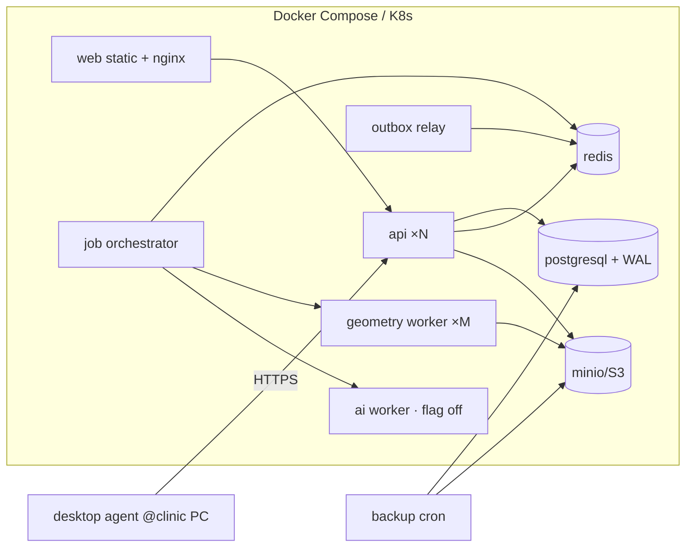

# 部署架构 V1.0

> 目标：一条命令起全栈（本地/实验室），同样拓扑可上云。**默认离线可用**——MVP 不依赖任何厂商 API。

## 1. 拓扑

## 2. 组件与环境

| 组件 | 镜像基线 | 关键 env（仅列名，值走 secret） |
|---|---|---|
| api | python:3.12-slim + fastapi/uvicorn | `DATABASE_URL`, `REDIS_URL`, `S3_*`, `JWT_SIGNING_KEY_REF`, `SECRET_STORE` |
| web | node:24 build → nginx:alpine serve | `API_BASE_URL` |
| postgres | postgres:16 | 数据卷、`shared_buffers`、WAL archive |
| redis | redis:7 | AOF 持久化（任务元数据） |
| minio | minio/minio | 版本控制开、生命周期策略、私有 bucket |
| geometry-worker | python:3.12-slim + 引擎候选 | `WORKER_CONCURRENCY`, `JOB_TIMEOUT`, `MAX_INPUT_MB` |
| ai-worker | 同上 + 推理依赖 | `AI_EXPERIMENTAL=off` 默认 |
| outbox-relay | 同 api 镜像 | `RELAY_BATCH`, `WEBHOOK_SIGNING_KEY_REF` |
| backup | postgres client + mc | 计划任务见 §4 |

## 3. 环境分层

| 环境 | 用途 | 数据 | 要点 |
|---|---|---|---|
| dev | 本地 docker compose | 合成数据 | MinIO+redis 全内置；无外部网调用 |
| staging | 验收/E2E | 脱敏样本 | 冻结版本镜像；开 AI flag 供评估 |
| prod | 实际部署 | 真实 PHI | TLS 必需、备份+演练、审计保留、访问最小化 |

## 4. 备份与恢复（SAFE-006）

- PG：`pg_basebackup` 每日 + WAL 连续归档；保留 30 天（可配）。
- MinIO：bucket versioning + 定期 `mc mirror` 到第二位置。
- **恢复演练**：每月自动演练脚本恢复至隔离环境并校验哈希链（E2E-16）；结果写 `backup_run`/`restore_drill`。
- 灾备 RPO ≤ 24h（初值，可收紧）；RTO 目标由部署方定义 `?`。

## 5. 升级与迁移

- Alembic 迁移，全部可回滚或前滚补偿；schema 与应用版本绑定发布。
- recipe/engine 版本独立于应用版本（AI-015/017）；升级不得改写历史 job 快照。

## 6. 资源建议（起步值，实测后回写）

| 组件 | dev | prod 起步 |
|---|---|---|
| api | 1c/512M | 2c/2G ×2 |
| postgres | 1c/1G | 2c/4G + SSD |
| geometry-worker | 1c/2G | 4c/8G ×2（按 job 时长调） |
| minio | 1c/512M | 磁盘按 STL 体量（均值×留存） |

## 7. 上线检查清单

TLS 终结+HSTS；管理端口不对公网；secret 不落 env 明文文件入仓；`AI_EXPERIMENTAL` 显式确认；审计表只追加验证；恢复演练最近一次 PASS；许可证 Gate（ADR-0007）未过不公开发行版镜像。
