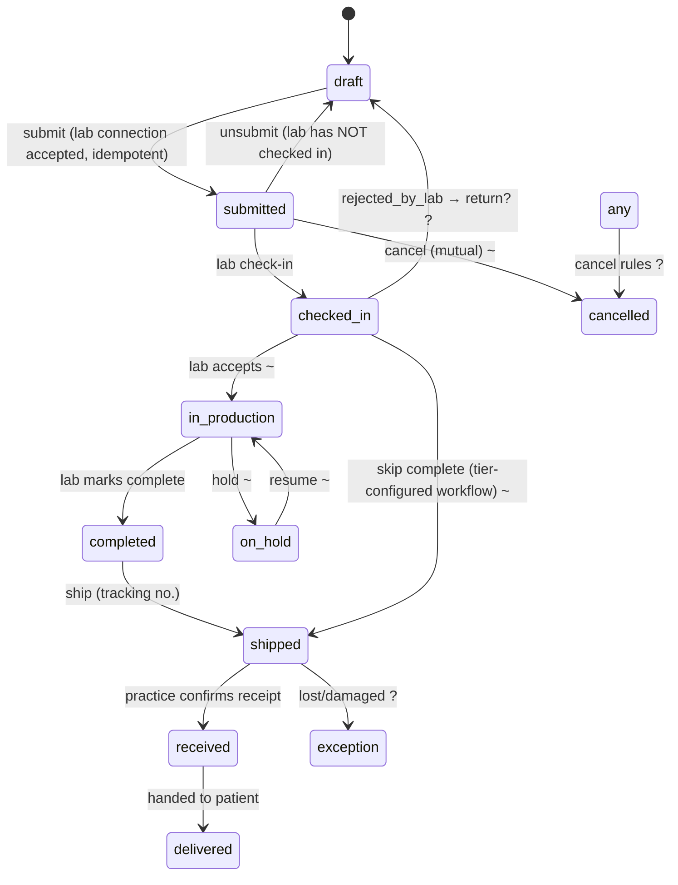
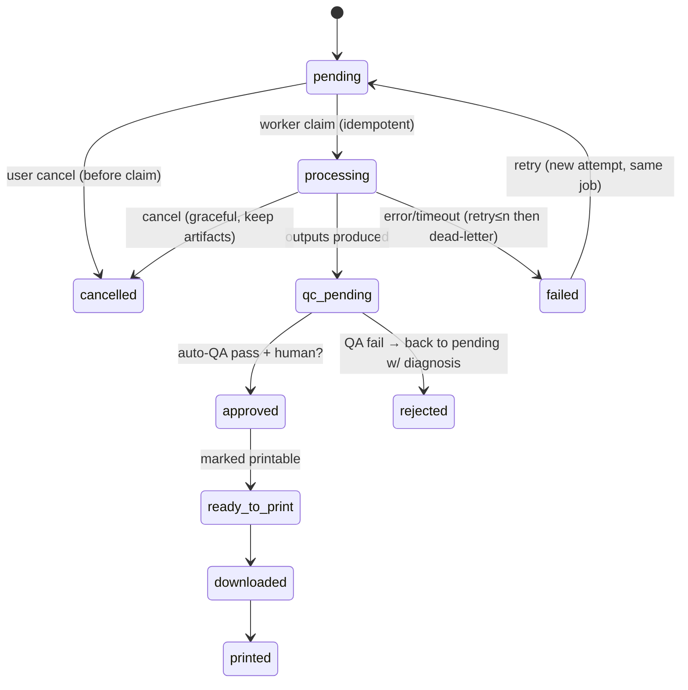
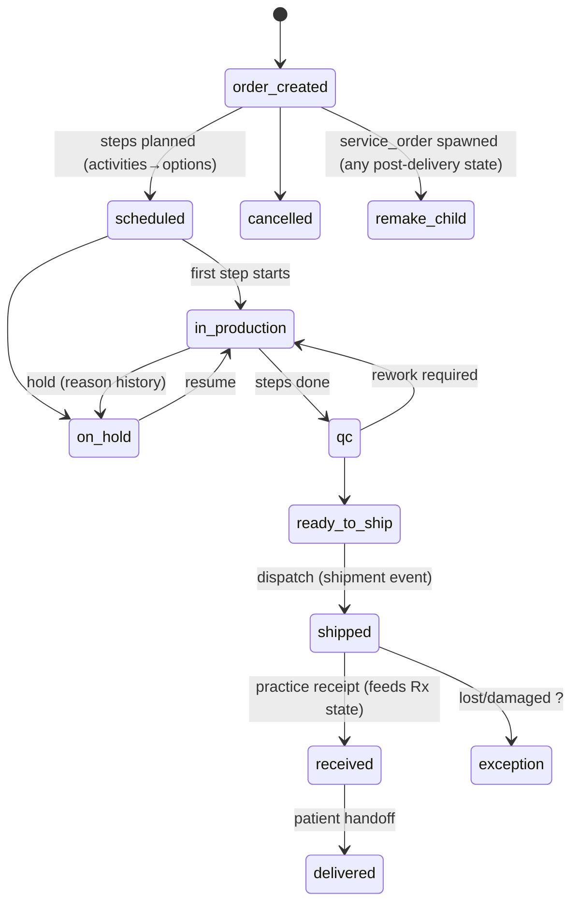

# 状态机 V1.0（Stage A 冻结）

> 规则：`= CONFIRMED` 官方/截图证据；`~ PROVISIONAL` 推断待验证；`? UNKNOWN`。
> 所有迁移写 `AUDIT_EVENT` + outbox 领域事件；迁移校验在服务层，不只在前端。

## 1. Rx 处方状态机

### 迁移表

| 迁移 | 触发者 | 前置条件 | 证据 | 事件 |
|---|---|---|---|---|
| draft→submitted | practice | lab_connection=accepted（E2E-04）；必填项齐；幂等键（E2E-07） | = D1 | `rx.submitted` |
| submitted→draft (unsubmit) | practice | lab 未 check-in（SRC24 =） | = | `rx.unsubmitted` |
| submitted→checked_in | lab | 显式接单；**ZIP 下载≠check-in**（FLOW-007 旧行为解耦 ~） | =/~ | `rx.checked_in` |
| checked_in→in_production | lab | ~ | ~ | `rx.production_started` |
| in_production→completed | lab | 可跳过（某些套餐工作流 ~，GAP-07） | =/~ | `rx.completed` |
| *→shipped | lab | tracking_no 可选?；允许 checked_in→shipped 直跳（~） | = | `rx.shipped` |
| shipped→received | practice | 收货确认 | = | `rx.received` |
| received→delivered | practice | 交付患者 | = | `rx.delivered` |
| *→cancelled | both? | 在途取消、已 check-in 取消的计费后果 ? | ? | `rx.cancelled` |
| *→on_hold / 重开 / redo | lab | FLOW-017 仅部分截图证据 | ? PROVISIONAL | `rx.on_hold`/`rx.reopened` |

**确认事实（SRC24 正文抽验）**：unsubmit → 回 Saved；checked-in 后不可 unsubmit（须线下与 lab 协商取消，计费由 lab 决定）；提交后仍可手动补传文件；iTero 自动附件仅限提交前。

**并发**：所有迁移携带 `expected_version` 乐观锁；双用户编辑冲突返回 409 不静默覆盖（E2E-15）。

## 2. 3D 加工任务状态机

| 规则 | 证据 |
|---|---|
| 每个 job 记录 input hash、recipe 版本、engine 版本、参数快照、输出 hash、QA 结论 | T(SAFE-007) |
| 失败保留源+参数+错误报告；一 Rx 上下颌可分别成败 | T(主报告§4.2) |
| `ready_to_print`/`downloaded`/`printed` 是**打印流转标记**，与文件加工状态解耦（AI-016） | = D1 |
| 人工编辑会话也落 PROCESSING_JOB(type=manual_edit)，走同一 QA gate（EDIT-014） | T |
| qc_pending→approved 是否必须人工复核：按 recipe.risk_level 配置 ~ | ? |

## 3. 实验室生产状态机

| 规则 | 证据 |
|---|---|
| 同一 Activity 可换 Production Option（人工/打印/外包），各自记录工时成本（非线性单价 ?） | = D1(SRC09) |
| Remake/Repair/Refinement = **关联原件的子单**，不改写历史记录（LAB-017/GAP-08） | =/T |
| received ≠ delivered：到所与交患者是两事件 | =（主报告§4.3） |
| 生产完成**不得**直接驱动 Rx=delivered | = |
| 排程冲突/资源占用规则 | ?（GAP-16） |

## 4. 领域事件目录（outbox，全部幂等）

`rx.created` `rx.submitted` `rx.unsubmitted` `rx.checked_in` `rx.changed` `rx.approval_requested` `rx.approved` `rx.rejected` `rx.cancelled` `rx.shipped` `rx.received` `rx.delivered` · `file.uploaded` `file.scan_clean` `file.scan_infected` · `processing.requested` `processing.completed` `processing.failed` `processing.qc_pending` · `production.order_created` `production.step_finished` `production.on_hold` `production.qc_passed` · `shipment.dispatched` `shipment.exception` · `notification.created` `approval.requested` `approval.decided` · `connection.requested` `connection.accepted` `connection.revoked`

事件 schema 必须含 `event_id, tenant_id, occurred_at, actor, object{类型,id,version}, payload_hash`；消费者幂等键 = `event_id`。

## 5. 未确认迁移登记（保持 UNKNOWN 不得实现为硬规则）

- Rx：运输中取消的处理与费用归属；lab 已编辑后医生再批准流程；cancelled 是否可重开。
- 加工：QC fail 后自动重试次数上限；approved 是否必须人工。
- 生产：并行工序依赖；外包工序的状态回传；remake 后原单状态。
- 套餐差异：哪些 lab 套餐跳过 completed（GAP-07）。

实现约束：上述 `?` 迁移在代码中必须表现为**可配置工作流 + 默认拒绝**，并附 `PROVISIONAL` 注释链回本文件。
