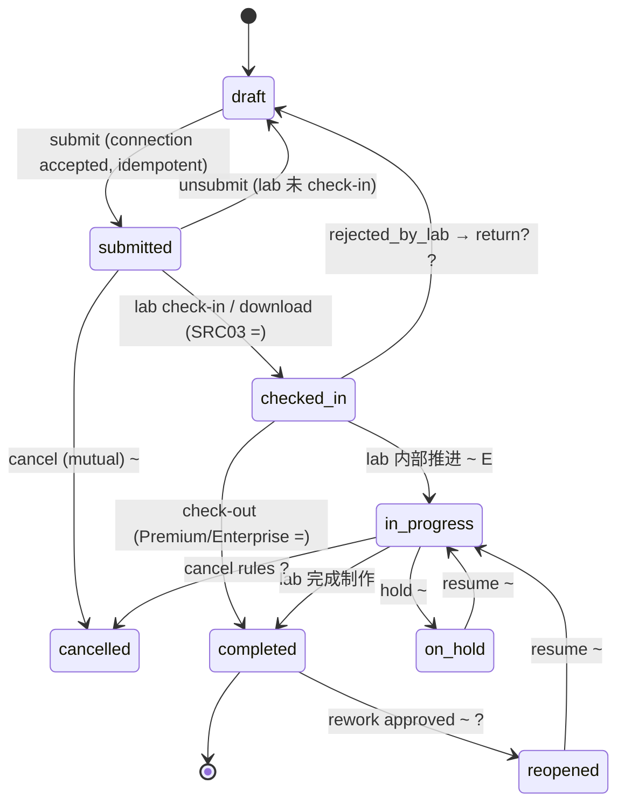
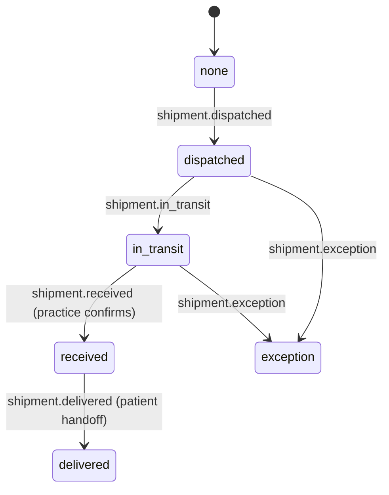
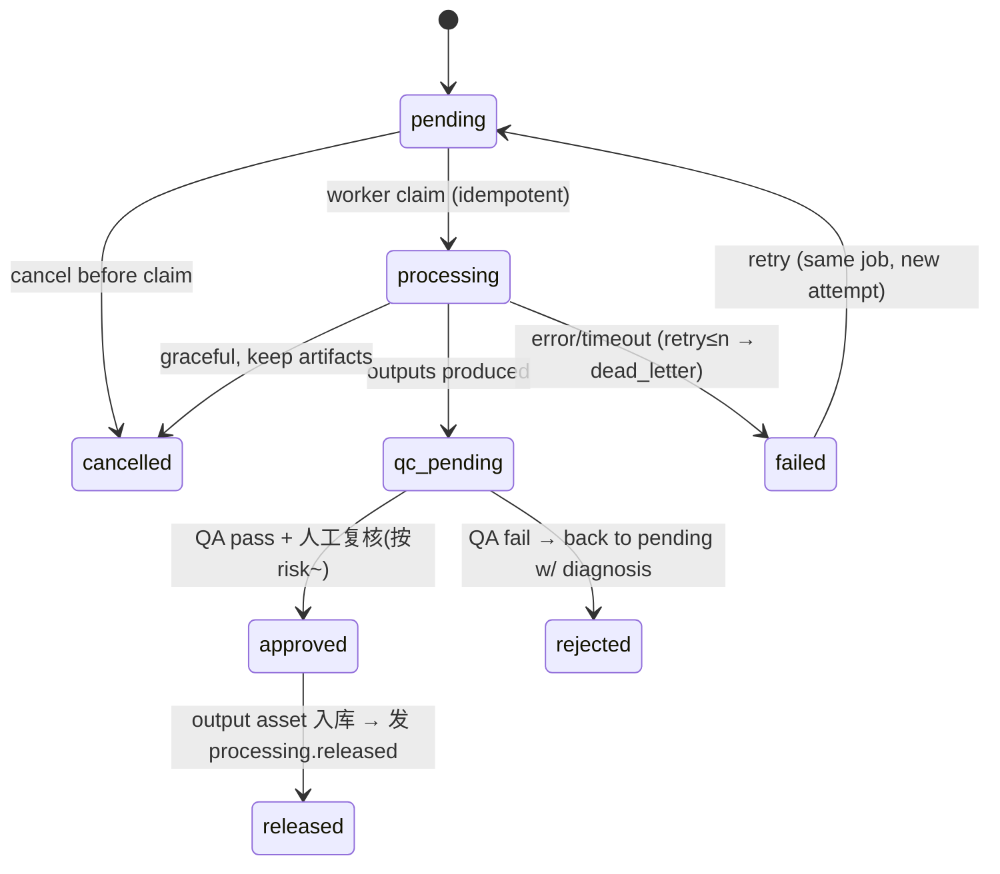
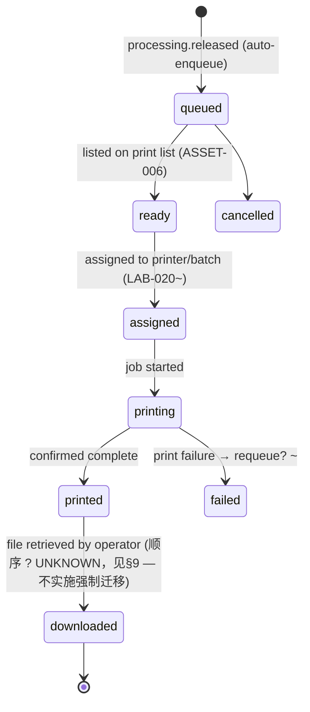
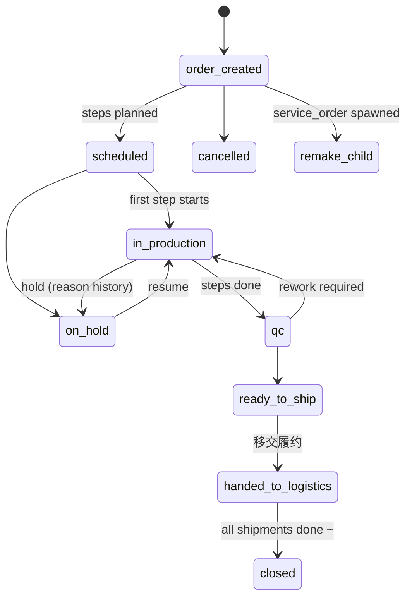
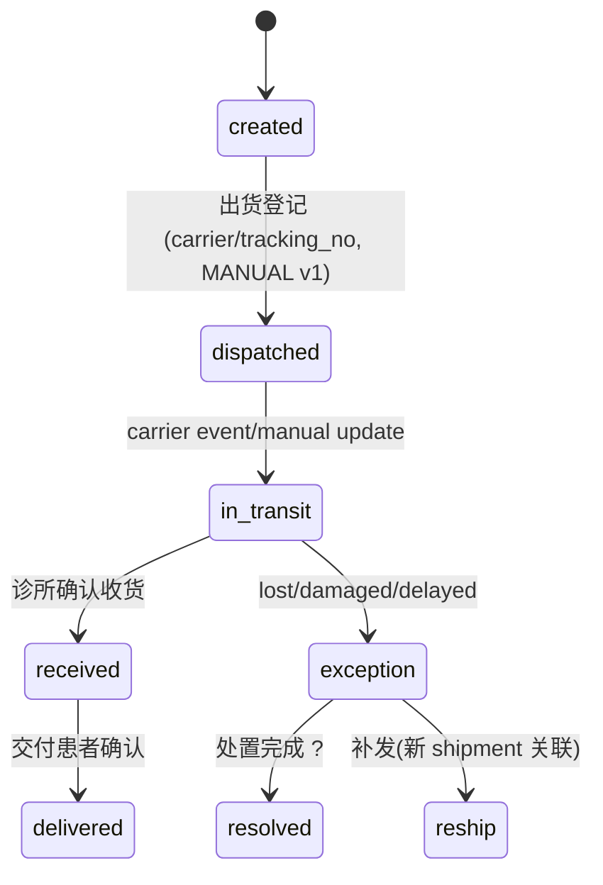

# 状态机 V1.1（Stage A.1 纠偏 — 状态边界修正）

> 规则：`= CONFIRMED` 官方/截图证据；`~ PROVISIONAL` 推断待验证；`? UNKNOWN`。
> **纠偏要点（A2）**：每条状态**唯一写入者**；区分**原始事实**与**事件投影**；禁止跨模块直写状态。
> 所有迁移写 `AUDIT_EVENT` + outbox 领域事件；校验在服务端，不在前端。

## 0. 状态所有权总表（纠偏核心）

| 状态字段 | 所在实体 | 唯一写入者 | 性质 | 下游投影 |
|---|---|---|---|---|
| `rx.status` | prescription | **rx 模块** | 原始事实（临床处方生命周期） | — |
| `rx.fulfillment_status` | prescription | **rx 投影消费者**（只能由 shipment.* 事件驱动） | 投影 | 工作台展示 |
| `production_order.status` | production_order | **mes 模块** | 原始事实 | rx 投影源之一 |
| `shipment.status` | shipment | **mes 模块（履约子域）** | 原始事实（物流唯一事实源） | rx.fulfillment_status |
| `processing_job.status` | processing_job | **processing 模块** | 原始事实（仅加工过程） | print_queue 入队 |
| `print_queue_item.status` | print_queue_item | **mes 模块（打印执行）** | 原始事实（打印流转） | 资产打印标记展示 |
| `asset.scan_status` | file_asset | **asset 模块** | 原始事实 | 引用可用性 |
| `approval.decision` | approval | **collab 模块** | 原始事实 | rx 变更通知 |

**铁律**：任何模块不得直接 UPDATE 不属于自己的状态字段；跨模块影响一律经事件 → 目标模块的投影消费者写入。例：lab 出货动作写 `shipment.status`（mes），**不**写 `rx.status`；rx 的投影消费者监听 `shipment.dispatched` 更新 `rx.fulfillment_status`。

## 1. Rx 处方状态机（仅临床生命周期，不含履约）

### 迁移表（唯一写入者：rx 模块）

| 迁移 | 触发者 | 前置条件 | 证据 | 事件 |
|---|---|---|---|---|
| draft→submitted | practice | connection=accepted；必填齐；签名；幂等键 | = SRC01/SRC28 | `rx.submitted` |
| submitted→draft (unsubmit) | practice | lab 未 check-in（SRC24 =） | = | `rx.unsubmitted` |
| submitted→checked_in | lab | 显式 check-in **或下载 Rx 包——下载即置 Checked-In（SRC03 =，V1.1 已证实；旧假设"下载≠接单"作废）** | = | `rx.checked_in` |
| checked_in→in_progress | lab | EasyRx 无公开等价态；EasyRS 内部推进阶段 | ~ E | `rx.in_progress` |
| checked_in→completed | lab | Premium/Enterprise check-out 记录日期；低套餐工作流可跳过（SRC03 =） | = | `rx.completed` |
| *→on_hold / →in_progress | lab | ~ EasyRS 自有语义 | ~ E | `rx.on_hold`/`rx.resumed` |
| *→cancelled | 双方? | 在途/已接单取消的费用后果 ? | ? | `rx.cancelled` |
| completed→reopened→in_progress | lab+practice | 返工审批 ?（FLOW-017 S） | ? | `rx.reopened` |

V1.1 校准注记（2026-02）：
- `draft` 对外语义即 EasyRx `Saved`；`submitted`/`checked_in`/`completed`/`shipped`/`received`/`delivered` 词汇均经 SRC01/03/26 正文证实。
- 下载触发 check-in 为官方行为：lab 侧 `Download`（ZIP 含 PDF+附件）将 Rx 置 Checked-In 并锁定撤回。EasyRS 实现为显式 `download_bundle` 动作，服务端记录 `checked_in_via∈{button,download}`，不做隐藏副作用。
- `completed` 为套餐门控能力（Premium/Enterprise Check-Out）；免费套餐工作流条跳过 Completed 直接 Shipped。
- `in_progress` 保留为 EasyRS 自有内部阶段（E），不对应任何已证实的 EasyRx 公开状态；若后续证据出现再校准。
- `rejected_by_lab→draft` 无证据，维持 `?` + 默认拒绝（SRC23 明确不建议为发通知而撤回）。

**移除出 Rx.status**：`shipped/received/delivered`（迁至 `rx.fulfillment_status` 投影与 `shipment.status` 事实）。理由：临床"处方已完成"与物流"货已交到患者"是两条时间线；把它们塞进同一 status 迫使两个模块共写一列。

## 2. 履约投影（rx.fulfillment_status — 派生，非事实）

- 字段类型：**投影列**，只能由 rx 投影消费者依 `shipment.*` 事件更新；不接受 API 直写。
- "3D 处理完成"/"生产完成"**不**驱动此投影；只有 shipment 事实源驱动（主报告 §4.3：收货≠交付）。
- 多批次发货（? UNKNOWN）→ 投影存最近事件 + `shipment_count`。

## 3. 3D 加工任务状态机（仅加工过程）

**移除出 job.status**：`ready_to_print/downloaded/printed`——它们是**打印执行状态**，归 `print_queue_item`（§4）。job 止于 `released`（产出已登记）。

| 规则 | 证据 |
|---|---|
| job 记 input hash/recipe+engine 版本/参数快照/output hash/QA 结论 | T(SAFE-007) |
| 失败保留源+参数+错误分类；一 Rx 上下颌分别成败 | T(§4.2) |
| 人工编辑会话同走 PROCESSING_JOB(type=manual_edit)+QA gate | T |
| qc→approved 是否必须人工：recipe.risk_level 配置 ~ | ? |

## 4. 打印队列状态机（新增——打印流转的唯一事实源）

| 规则 | 证据 |
|---|---|
| `ready/downloaded/printed` 语义来自 AI-016 的"打印流转标记"观察；字段归属打印队列而非加工 job（纠偏） | = D1(存在)/~(归属) |
| 打印失败可重回 queued，保留失败记录 | ~ |
| 打印完成不回写加工 job（job 已 released 封闭） | T |

## 5. 生产订单状态机（唯一写入者：mes 模块）

| 规则 | 证据 |
|---|---|
| Activity 可换 Production Option，各自工时成本（非线性 ?） | = D1(SRC09) |
| Remake/Repair/Refinement = 关联父单子单，不改写历史 | =/T |
| `ready_to_ship→handed_to_logistics` 发出 `shipment.dispatched` 由履约子域接收——订单不直接写 shipment（唯一写入者规则） | T(纠偏) |
| 排程冲突/并行工序依赖 | ?（GAP-16） |

## 6. 物流状态机（唯一写入者：mes 履约子域 — shipment 为物流唯一事实源）

| 规则 | 证据 |
|---|---|
| shipment 独立于 Rx 与 order 成为物流事实源（A2 纠偏）；Rx/order 只见投影 | T(纠偏)+D1(FLOW-012/013,LAB-019) |
| `received`(到所) 与 `delivered`(交患者) 两事件分离 | = |
| 收货确认动作权限=practice；登记动作=lab；状态写入者仍唯一（mes 履约子域接受两方事件） | =/T(纠偏) |
| 追踪事件可来自手工录入（MVP）或承运商 webhook（P3） | MANUAL/~ |

## 7. 跨模块事件映射（一致性保证）

| 上游事件 | 消费方 | 写入（唯一） | 效果 |
|---|---|---|---|
| `rx.checked_in` | mes | 新建 production_order(draft) | 接单→建单 |
| `production.ready_to_ship` | mes-fulfillment | 允许创建 shipment | 出货前置 |
| `shipment.dispatched` | rx projection | `rx.fulfillment_status=dispatched` | 工作台见已发货 |
| `shipment.received` | rx projection | `=received` | 诊所视角收货 |
| `shipment.delivered` | rx projection | `=delivered` | 履约闭环 |
| `processing.released` | print_queue | 入队 print_queue_item | 可打印 |
| `print_queue.printed` | (展示投影) | 资产"已打印"标记 | 不落加工 job |
| `order.closed`(全部发货) | rx projection | 可选"全部到货"标记 ~ | 汇总会 |

## 8. 领域事件目录（outbox，全部幂等）

`rx.created` `rx.submitted` `rx.unsubmitted` `rx.checked_in` `rx.in_progress` `rx.completed` `rx.on_hold` `rx.resumed` `rx.reopened` `rx.cancelled` `rx.approval_requested` `rx.approved` `rx.rejected` · `file.uploaded` `file.scan_clean` `file.scan_infected` · `processing.requested` `processing.completed` `processing.failed` `processing.qc_pending` `processing.released` · `print.enqueued` `print.assigned` `print.printed` `print.failed` · `production.order_created` `production.step_finished` `production.on_hold` `production.qc_passed` `production.ready_to_ship` `production.closed` · `shipment.created` `shipment.dispatched` `shipment.in_transit` `shipment.received` `shipment.delivered` `shipment.exception` `shipment.resolved` · `notification.created` `approval.requested` `approval.decided` · `connection.requested` `connection.accepted` `connection.revoked`

事件 schema：`event_id, tenant_id, occurred_at, actor, object{type,id,version}, payload_hash`；消费幂等键=`event_id`。

## 9. 未确认迁移登记（保持 UNKNOWN，不得实现为硬规则）

- Rx：运输中取消的费用归属；lab 编辑后医生再批准；cancelled 可否重开。
- 加工：QC fail 自动重试上限；approved 是否必须人工。
- 生产：并行工序依赖；外包状态回传；remake 后原单状态。
- 打印：printed↔downloaded 官方语义顺序（AI-016 只证明三标记存在）——B0-01 确认：**保持 UNKNOWN，实现层不得强制 `printed→downloaded` 为唯一迁移**，允许操作者独立记录 downloaded。
- 套餐差异：哪些 lab 套餐跳过 completed（GAP-07）。

实现约束：上述 `?` 迁移必须表现为**可配置工作流 + 默认拒绝**，并附 `PROVISIONAL` 注释链回本文件。
