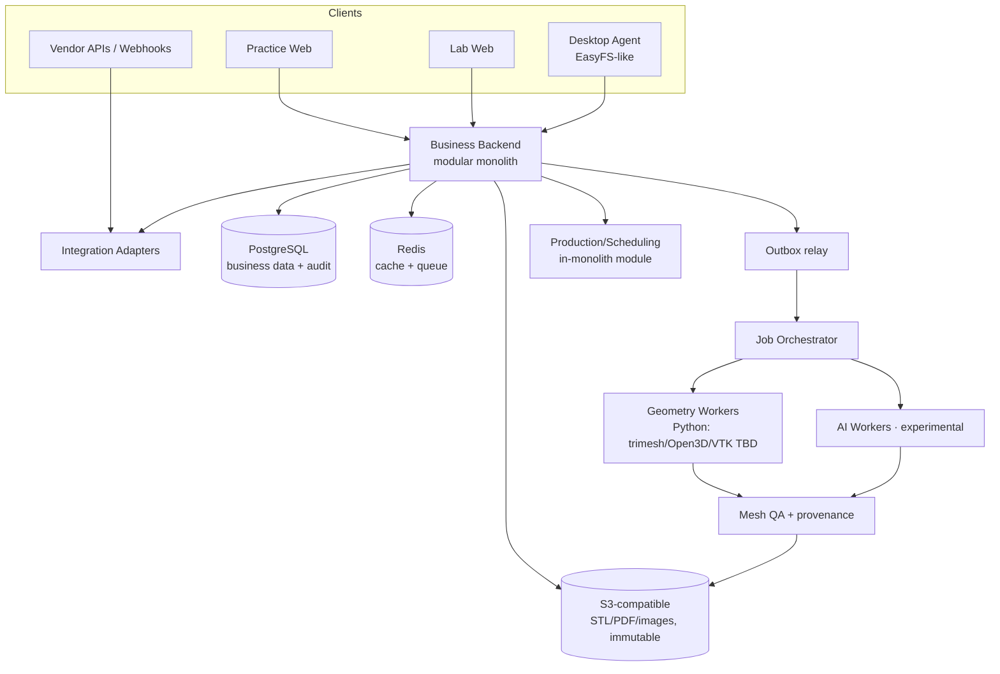

# 系统设计 V1.0 — 模块化单体 + 独立几何计算

> 定位：可自托管、可开源的正畸处方 + 技工室生产协同平台。原则：**业务模块化单体，3D 计算独立扩缩，厂商适配器边缘化**。决策明细见 `adr/`。

## 1. 总体视图



**为什么不是微服务**：团队规模与域复杂度不足以抵消分布式事务/部署成本；模块边界用包结构 + 数据所有权强制（ADR-0001）。几何/AI 因 CPU/GPU 画像与 Python 生态独立部署（ADR-0003）。

## 2. 后端模块划分（单体内）

| 模块 | 拥有实体 | 对外 |
|---|---|---|
| identity | tenant/org/user/membership/role/connection | REST + RLS 谓词 |
| patient | patient/treatment_case | REST |
| rx | prescription/rx_item/catalog/template/annotation/pdf | REST + 状态机 API |
| collab | comment/notification/approval/tag/view/feedback/form | REST + WS(可选~) |
| asset | file_asset/reference/upload_session/access_grant | REST + 分块上传 + 预签名 |
| processing | recipe/job/qa_report | REST + 内部 gRPC/queue → workers |
| mes | production_order/item/workflow/step/ticket/shipment/service/hold | REST |
| finance | price/proposal/invoice/payment/adjustment/statement/report | REST |
| integration | connection/scan_event/webhook/agent | adapters |
| platform | audit/event/outbox/backup/export/retention | 横切 |

模块间只经服务接口调用；**禁止跨模块写表**。跨模块读走查询端口（只投影必要列）。

## 3. 关键流

### 3.1 提交 Rx
```
client → POST /rx/{id}:submit (Idempotency-Key)
  → tx: rx.status draft→submitted (version check, connection=accepted)
  → outbox rx.submitted → notification to lab, dashboard counters
```
失败语义：version 冲突 409；连接缺失 422+E2E-04 提示；重复提交同 key → 200 返回首次结果。

### 3.2 STL 上传
```
POST /uploads (declare size,sha256,kind,jaw) → upload_session + S3 multipart URLs
complete → file_asset(quarantine) → async AV/mesh scan
  clean → file_reference 授权 + rx.changed 事件
  infected/failed → 隔离，不暴露下载，审计记录
```
断网重传：客户端重发同 hash → 续传或秒传（E2E-12）；任何失败不产出半文件资产。

### 3.3 3D 加工
```
POST /processing-jobs {asset,recipe_version,idempotency_key}
  → job pending → orchestrator → worker 拉取(minio 内部 URL)
  → worker 输出新 asset + qa_report → job qc_pending
  → QA pass → approved → ready_to_print(print_status 独立)
```
重试：attempt≤N 指数退避 → dead_letter + 人工；取消：claim 前立即取消，运行中优雅中止并保留中间产物（AI-017）。

### 3.4 通知审批
```
lab 建 approval_required 通知 → outbox → practice 收件箱+email(按 pref)
practice 决策 → approval{decision,signature,rx_version} → rx.changed
```
决策绑定 Rx 版本：版本漂移须重新确认（~ PROVISIONAL）。

## 4. 数据存储决策

| 决策 | 方案 | ADR |
|---|---|---|
| 业务库 | PostgreSQL 16；行级租户 RLS + app 谓词双保险 | 0006 |
| 大文件 | S3/MinIO，hash 寻址 `sha256` 键，不可变 | 0004 |
| 队列 | Redis + 轻量 orchestrator（先 BullMQ/Arq 级，非 Kafka） | 0005 |
| 事件 | PG outbox 表 + relay；消费者幂等 | 0005 |
| 秘钥 | 外部 secret store（env/SSM/Vault 可插拔），DB 只存引用 | 0004 |
| 备份 | pg_basebackup+WAL + S3 versioning；恢复演练为 SAFE-006 验收项 | deployment.md |

## 5. 前端决策

React + TypeScript + Vite；Three.js 3D 视图（大网格 LOD/分块待 PoC 基准）；组件库待定 ~；表单层必须支持"草稿恢复不丢状态"（E2E-02）。Practice 与 Lab 同一代码库按 realm 路由/主题/权限裁剪，不分仓。

## 6. 集成与适配器

`integration` 模块定义 vendor-agnostic SPI：`ScanSource`（iTero/TRIOS/Medit/DEXIS/通用 STL）、`PrintSink`（Formlabs/NextDent…）、`PMSBridge`（Dolphin/Open Dental…）、`DesktopSync`（EasyFS 类）。每个厂商一个适配器包；**无授权不接真实 API**（GAP-14），MVP 仅实现手动导入 + SPI 契约。公开面：OpenAPI 3.1 + Webhook（HMAC-SHA256 签名，见 security-baseline）。

## 7. 性能与规模假设（初值，可调）

- 单部署目标：≤200 机构、≤50k Rx/年、STL 峰值 200MB/文件、并发编辑 <100。
- 大网格渲染与几何操作基准由 PoC 实测后回写（`poc/`）。
- 几何 worker 水平扩缩与 API 解耦；AI worker 默认禁用（feature flag `ai.experimental`）。

## 8. 可观测性

结构化日志（tenant/org/request/trace id）、Prometheus 指标（队列深度、job 时长、失败率）、OpenTelemetry trace（API→queue→worker）。审计事件不是日志：审计写 DB 追加表。

## 9. 质量属性 ↔ 证据锚点

| 属性 | 机制 | 验收锚点 |
|---|---|---|
| 租户隔离 | RLS+谓词+连接授权边 | E2E-03 |
| 幂等 | Idempotency-Key + 事件去重 | E2E-07 |
| 文件不可变 | hash 寻址+parent 链 | ASSET-009 |
| 可追溯 | job 全参数快照+签名 | SAFE-007 |
| 可恢复 | 断点续传+备份演练 | E2E-12/16 |
| 不静默覆盖 | 乐观锁 409 | E2E-15 |
