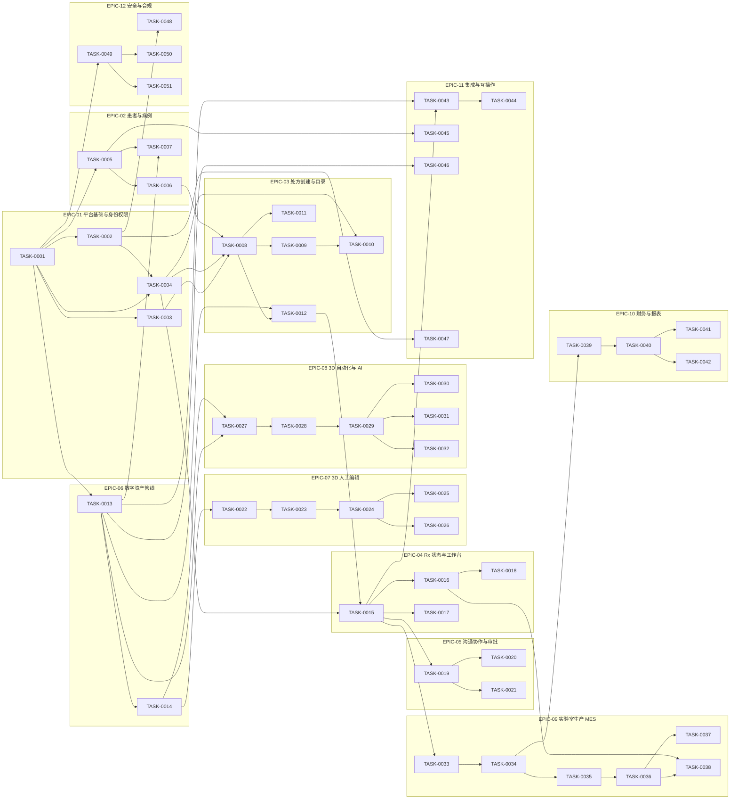

# Epics — Stage A 开发任务分组

> 生成自 `tools/backlog_tasks.py`。Task 可跨 Epic 引用 Feature；Epic 归属按任务主体。

| Epic | 名称 | 域 | 任务数 | Feature 覆盖 | 任务文件 |
|---|---|---|---:|---:|---|
| EPIC-01 | 平台基础与身份权限 | Organization & IAM | 4 | 12 | [tasks/EPIC-01-iam.md](tasks/EPIC-01-iam.md) |
| EPIC-02 | 患者与病例 | Patient & Case | 3 | 8 | [tasks/EPIC-02-patient.md](tasks/EPIC-02-patient.md) |
| EPIC-03 | 处方创建与目录 | Prescription & Templates | 5 | 22 | [tasks/EPIC-03-rx.md](tasks/EPIC-03-rx.md) |
| EPIC-04 | Rx 状态与工作台 | Rx Dashboard & Status | 4 | 18 | [tasks/EPIC-04-workflow.md](tasks/EPIC-04-workflow.md) |
| EPIC-05 | 沟通协作与审批 | Communication & Collaboration | 3 | 11 | [tasks/EPIC-05-collaboration.md](tasks/EPIC-05-collaboration.md) |
| EPIC-06 | 数字资产管线 | Digital Asset Management | 2 | 12 | [tasks/EPIC-06-assets.md](tasks/EPIC-06-assets.md) |
| EPIC-07 | 3D 人工编辑 | 3D Editing | 5 | 14 | [tasks/EPIC-07-editing.md](tasks/EPIC-07-editing.md) |
| EPIC-08 | 3D 自动化与 AI | 3D AI Processing | 6 | 18 | [tasks/EPIC-08-automation-ai.md](tasks/EPIC-08-automation-ai.md) |
| EPIC-09 | 实验室生产 MES | Laboratory Production | 6 | 20 | [tasks/EPIC-09-lab-mes.md](tasks/EPIC-09-lab-mes.md) |
| EPIC-10 | 财务与报表 | Financial & Reporting | 4 | 14 | [tasks/EPIC-10-finance.md](tasks/EPIC-10-finance.md) |
| EPIC-11 | 集成与互操作 | External Integrations | 5 | 12 | [tasks/EPIC-11-integrations.md](tasks/EPIC-11-integrations.md) |
| EPIC-12 | 安全与合规 | Security & Compliance | 4 | 6 | [tasks/EPIC-12-security.md](tasks/EPIC-12-security.md) |

## 依赖概览

