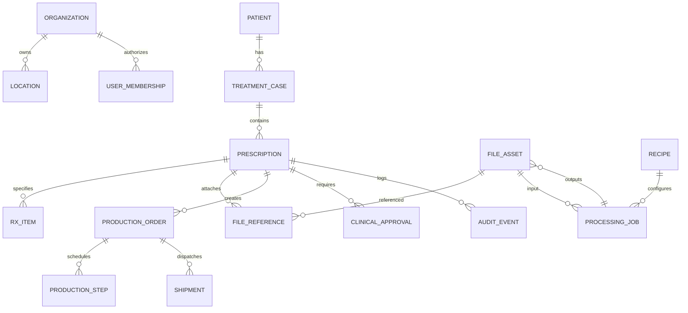
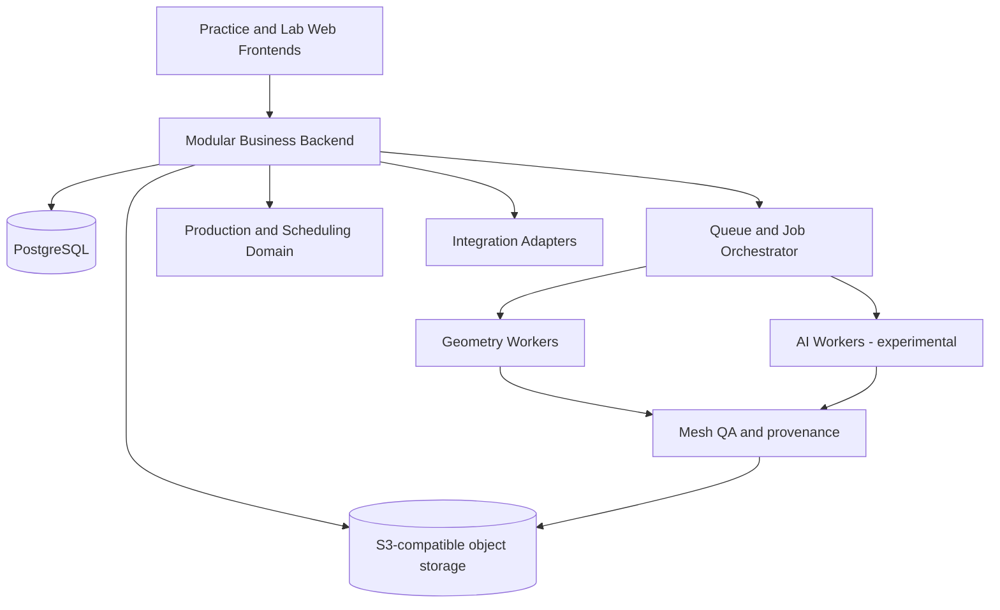

# EasyRx 开源替代系统功能总清单与差距分析 V1.0

> **研究日期**：2026-10-24  
> **状态**：资料研究基线 / 尚未进行系统级实测 / 非功能等价证明  
> **对象**：EasyRx Practice、EasyRx Lab、EasyRx 3D、VisualDLP 公开功能，以及用户授权提供的五张界面截图。  
> **目标**：建立能够独立实现、可自行部署、可开源的正畸处方和数字化技工室生产管理平台。  
> **关联交付**：`easyrx_feature_inventory_v1.csv`（逐项追踪） / `easyrx_source_index_v1.csv`（来源） / `easyrx_inventory_v1.json`（机器可读）。

## 0. 执行摘要

**核心判断**：公开资料足以支持“业务系统”独立实施的需求勘测与原型开发，**不足以保证 100% 功能覆盖或 3D/AI 临床与生产精度等价**。官方知识库和视频目录覆盖用户、处方、模板、技工室、人工 3D 编辑、自动 3D 加工、生产排程、金融与第三方集成；具体鉴权、异常状态、厂商 API、算法、真实迁移能力还需要验证。

本报告共登记 **167 个需求条目，横跨 12 个模块**：官方详细正文直接支持 **118** 条、官方目录或视频提纲只确认存在 **23** 条、用户截图单独支持 **4** 条、为新平台建议而非旧系统功能事实 **22** 条。此计数是**本报告人工挑选和拆分需求项的数量**，不是 EasyRx 原厂功能总数，也不是完成率。37 个索引标识中有一项是私有截图集合，不可进入公开仓库。

### 研究结论分层

| 分层 | 现阶段结论 | 需要补充的证据 | 建议启动动作 |
|---|---|---|---|
| L1 业务结构（机构/患者/Rx/协作） | 可独立重建，证据较强 | 当前账号权限、异常和边界状态 | 先做 PRD、状态机与试验性 UI |
| L2 Lab/MES/Financial | 主要概念明确，细则未齐 | 生产排程细则、定价税务、订单与 Rx 的转换 | 生产模块独立域建模，财务延后 |
| L3 浏览器 STL 编辑 | 人工步骤较清楚，可做 PoC | 不同坏网格与坐标变换的质量验证 | 先做 STL + 几何 QA |
| L4 自动几何/AI/PTS | 产品参数可见、实现细节严重不足 | 脱敏样本、标注、公差、设备输出协议 | 独立高风险研发线，不能承诺等价 |
| L5 商业厂商集成 | 知道对接对象，不等于有接入授权 | API/SDK、合作合同、测试环境 | 先统一适配器，第一期只支持手动导入 |
| L6 隐私安全/运营 | 属于新系统必须自建的保障 | 目标司法辖区、数据保留、责任分配 | MVP 同步建设，不等到上线才做 |

**定量结构**：MVP 72 项、P1 48 项、P2 39 项、P3 8 项。这里的“MVP”是需求分组而非首个迭代任务量；真正第一批开发需再缩为 25–35 条基础闭环任务，详见 §9。

## 1. 范围与调查方法

### 1.1 已纳入

- EasyRx Practice 的机构配置、患者、Rx Workspace、Parts/Appliances/Templates、Aligner/IDB、筛选、追踪、通知。
- EasyRx Lab 的诊所连接、处方接收、修改、Check-in、出货、反馈、客户价目。
- EasyRx 3D 的 STL 预览与人工加工，以及 Command Center 自动处理配置、ABS/ABR/AI Blockout/PTS、标志与打印列表。
- VisualDLP 的生产订单、工作流、活动、生产方式、费用和财务报表。
- EasyFS 类本地文件访问、口扫与打印软件接口的可替代性。
- 独立开源项目的权限、审计、备份、医疗数据保护等基础设施。

### 1.2 本轮尚未完成

- **未逐一播放全部 YouTube/EasyVid 视频**，视频索引只能证明教程列出的主题，不代表视频细节已验证。
- **未登入并操作真实 EasyRx 账户**，未访问隐藏管理界面、实际 API 或数据库。截图仅为所给 5 张；未保存真实患者信息到交付文件。
- **未执行 STL 样本试验**，未得到实际几何公差、准确率、算法模型权重或 PTS 硬件协议。
- **未做知识库的全网穷举抓取**；本轮为高价值模块定向核验，因此 V1.0 不是声称“完整枚举了厂商全部功能”。
- **未判定任何具体许可、隐私或医疗器械合规结论**；须结合实施国家/省、销售模式和软件宣称用途经专业审核。

### 1.3 证据分级

| 标记 | 含义 | 使用时的正确措辞 |
|---|---|---|
| D1 | 本轮打开的官方文章正文直接描述了该能力或规则 | 官方文档支持其存在，参数及最新行为仍应实测 |
| D2 | 官方知识库目录、教程提纲或短介绍提及 | 可以确定该主题存在，具体实现条件未完全确认 |
| S | 仅从用户提供的系统截图辨认 | 截图可见，未实测其逻辑 |
| T | 我们建议开源系统独立加入的设计，不主张 EasyRx 已实现 | 目标能力/安全标准，不属于复制证据 |

请同时查看 CSV 的 `missing_or_risk` 字段，不要把 D1 误读为已经测试或适配所有账号计划。官方文档可能具有历史版本差异。

## 2. 功能矩阵概览

| 模块 | 条目 | 主要内容 |
|---|---:|---|
| 机构与权限 | 12 | 详见附表中 `IAM-*` |
| 患者与病例 | 9 | 详见附表中 `PAT-*` |
| 处方创建与模板 | 21 | 详见附表中 `RX-*` |
| Rx状态与工作台 | 17 | 详见附表中 `FLOW-*` |
| 沟通与协作 | 12 | 详见附表中 `COM-*` |
| 3D文件与资产 | 10 | 详见附表中 `ASSET-*` |
| 3D人工编辑 | 14 | 详见附表中 `EDIT-*` |
| 3D自动化与AI | 17 | 详见附表中 `AI-*` |
| 实验室与生产MES | 20 | 详见附表中 `LAB-*` |
| 报价财务与报表 | 14 | 详见附表中 `FIN-*` |
| 集成与互操作 | 11 | 详见附表中 `INT-*` |
| 系统保障与合规 | 10 | 详见附表中 `SAFE-*` |

### 2.1 最重要的业务功能

1. **Rx 是临床处方与实验室需求的中心**：创建者、患者、诊所地点、医生、实验室、部件/牙位、备注、文件与需要日期等必须进入统一对象（官方 Practice Step-by-step；EasyVid）。
2. **产品定义具层级**：Parts（零件）→ Appliances（产品）→ Templates（可重用处方配置）；实验室可向医生授权分享模板。官方称其通用库包含 500+ 类部件与器械，但**不意味着这些素材允许开源复制**。
3. **“处方状态”与“生产订单状态”不同**：有些实验室账户的工作流会跳过 Completed，有些有更多工序；VisualDLP 则具有独立的生产 Activity/Production Option 体系。
4. **模型文件与任务分离**：原始 STL、优化 STL、加工 STL、打印就绪与打印完成标记不能混为一个状态。
5. **生产工序可以换方法**：同一 Activity 可采用人工、打印或外包等 Production Options，各自记录工时/成本，甚至存在非线性的单位成本。
6. **通知不是普通聊天**：临床通知可以要求医生签署批准，必须有结构化决策和附件版本绑定。

## 3. 业务对象与数据关系（拟议，非 EasyRx 真实数据库）

**建议的唯一标识与边界**：

- `tenant_id`（数据所有者），`organization_id`（诊所/实验室），`location_id`（实体地点）不得混淆。多机构合作用显式授权边，不允许通过猜测 URL 访问。
- `patient_id` 采用内部随机 ID，外部患者编号加来源机构做复合唯一键；不能凭“同名”自动合并。
- `case_id` 用于一个治疗过程多次处方；`rx_id` 不能因为退回重提而改变。
- `file_asset_id` 标记不可变二进制数据，`file_reference` 控制与病例/Rx 的授权关系；版本关系通过 `parent_asset_id` 与 provenance 追溯。
- `processing_job_id` 每次操作唯一，保存输入 hash、配方版本、引擎版本、参数、输出 hash、执行时间与 QA 结论。
- `production_order_id` 可引用一个 Rx 下多项产品；`production_step_id` 承载人员/设备/成本/开始完成时间。

## 4. 三套状态机与关键规则

### 4.1 Rx 处方状态（建议结构）

`DRAFT → SUBMITTED → CHECKED_IN → COMPLETED → SHIPPED → RECEIVED → DELIVERED`

- 文档支持：未 Checked-in 时，处方可以 Unsubmit 返回 Saved；已 Checked-in 后不允许简单撤回。
- 文档支持：某些实验室计划可不经过 Completed 直接 Shipped；因此建议用配置化 workflow，而不是硬编码所有节点。
- 文档支持：实验室下载 ZIP 也可能造成自动 Check-in。这是一种旧行为，**新项目可将“仅下载”与“正式接单”解耦**，但为兼容要明确区别。
- 已提交之后能追加文件；自动 iTero 附件和人工上传的前置条件不同，不能笼统规定“一经提交不许编辑”。
- 需要人工复验的点：取消在运输途中如何处理；实验室已编辑后的医生批准；多人并发修改；重复提交的幂等；财务退款/赔偿。

### 4.2 文件加工状态

`ORIGINAL → OPTIMIZED → PROCESSING → QC_PENDING → APPROVED / REJECTED → READY_TO_PRINT`

**注意**：这是本项目建议，不是厂商原始状态字段。原始 STL 永不覆盖；每次失败仍保留源、参数与错误报告；一张处方上下颌多文件可分别成功/失败。

### 4.3 实验室生产与物流状态

`ORDER_CREATED → SCHEDULED → IN_PRODUCTION → QC → READY_TO_SHIP → SHIPPED → RECEIVED → DELIVERED`

- 每件产品可有多个工作步骤、不同生产选项。
- 收货与交到患者手中是两个事件；“3D 处理完成”不能触发“已交付”。
- Remake / Repair / Refinement 建议建成**关联原件的服务/返工子单**，不要简单改写历史生产记录。

### 4.4 关键事件

建议使用 Outbox + 可重放事件：`rx.created`、`rx.submitted`、`rx.checked_in`、`rx.changed`、`rx.approval_requested`、`rx.approved`、`file.uploaded`、`processing.requested`、`processing.completed`、`processing.failed`、`production.step_finished`、`shipment.dispatched` 等。所有消费者实现幂等处理。

## 5. 3D 功能拆分与算法差距

### 5.1 人工编辑可研究范围

官方教程的步骤非常具体：原始模型进入后先 Orient、手动绘 Trim 线及调整节点、Trim/Cut、实心或中空 Base、排液孔、文字 Engrave/Emboss、保存派生文件。这些足以用于设计独立 GUI 和几何 PoC，但不能替代真实三维算法精度测试（来源 SRC05/SRC06）。

| 功能 | 候选独立实现 | 验收核心 | 当前差距 |
|---|---|---|---|
| STL 预览 | Three.js + 网格分块/LOD | 大模型加载、旋转、缩放流畅 | 需样本性能基准 |
| Orient | 交互式基准点+矩阵变换 | 坐标和咬合保持 | 基准点规则不明 |
| 网格优化 | Trimesh / Open3D / VTK 比较 | watertight、自交、面数、体积报告 | 缺大量扫描质量样本 |
| 手动裁剪 | 交互式曲线投射 + 保留侧求解 | 复杂凹面/开口网格能正确截取 | 算法路径与鲁棒性未证 |
| Regular/Hollow Base | 法向/投影、网格偏置、布尔封合 | 实测高度/壁厚/体积且可打印 | 薄壁自交与局部容差 |
| 刻字/凸字 | 文字轮廓转三维+布尔操作 | 字符完整、清晰、无悬浮部件 | 病人隐私与字体授权 |
| 自动去托槽 | 点云/网格分割 + 几何重建 | 牙冠几何偏差及局部风险审阅 | 算法、标注、测试集均缺 |
| AI Blockout | 解剖区域识别+倒凹优化 | 不干涉预期贴合并有人工把关 | 医工指标尚未定义 |
| PTS trim path | 牙龈边界识别+曲线偏移+机器导出 | 设备厂商实测一致性 | 机器格式/法线/精度缺失 |

### 5.2 官方确认的自动化参数

`processing_mode`（Automatic / On-Demand）；`trim_type`（Horseshoe/Full Palate 等）；`trim_margin_mm`；`base_height_mm`；`model_type`（Regular/Hollow）；`wall_thickness_mm`；`label_position`；`preserve_occlusion`；`extrude_palate`；自动 PTS 类型（Straight/Hybrid/Scalloped/Half & Half/Mouthguard）；`gingival_clearance_mm`；`preserve_molars`；`molar_edge_distance_mm`；`include_normals`。

其中 **官方说明 PTS Gingival Margin Clearance 应至少比 Trim Margin 小 0.5 mm**，这是参数联动约束的例子，不应脱离实际页面版本直接固定成临床标准；见 SRC04。每个加工配方必须 `version` 固定并写入结果溯源。

### 5.3 初期 3D/AI Gate

- G3D-01：STL unit/scale、mesh manifold/watertight、边界/自交、定位和修复失败分类均可自动检查。
- G3D-02：人工裁剪和加底座可见差异叠加；具备撤回、重做、QA 阻断。
- G3D-03：按 30–50 个经许可且脱敏的代表性扫描文件建立样本库，按病例和原扫描会话切分数据，避免训练/测试泄漏。
- G3D-04：由合作技工/临床专家先定义公差、拒绝条件和外观测量，再决定 AI 是否可进入试生产；**不能自创统一“医学合格率”**。
- G3D-05：打印样件和机器对接需要实物验收；只看 STL 预览通过不算生产完成。

## 6. VisualDLP 与 Lab MES 差距

官方 VisualDLP 的 **Workflow → Activities → Production Options** 已经表明它不是一个简单订单看板：一个产品可通过工序链分天生产，一个活动有多种生产方式，各方式拥有不同工时成本，并允许非线性计价（SRC09）。此外还有订单录入、工作票、挂起、Remake、Price Lists、Invoice、Payment、Statement、Report 等公开主题（SRC10/SRC17/SRC18/SRC19）。

**推荐的独立实现域**：

- `ProductCatalog` 产品/材料/附属产品；
- `Workflows` 工序模板、活动与方法；
- `Scheduling` 交期/班次/资源/节假日；
- `Production` 工单、任务/人员、设备、完成记录；
- `Quality` 工序QC、不合格、返工；
- `Finance` 报价快照、发票、交易、账单与报表。

**目前不足**：VisualDLP 实际与 EasyRx Rx 数据同步方向、售后 Remake 计费、库存/条码业务、并行工序依赖与订单财务快照仍缺实测。不要只从上级 KB 分类推断所有字段存在。

## 7. 外部设备与互操作策略

公开目录列有 iTero、TRIOS、Medit、DEXIS、Dolphin、Cloud9、Ortho2、TOPS、Open Dental、Formlabs、NextDent 及其他厂商。但**官方对 EasyRx 的集成能力不等于我们的软件自动取得合作伙伴接口调用权**（SRC14）。

| 阶段 | 集成方法 | 验收 |
|---|---|---|
| MVP | 用户手工导入 STL/PDF 和 CSV | 无厂商账户仍能完整走通业务闭环 |
| P1 | 本地目录监听/桌面代理的授权读取 | 断点续传、重复文件合并、隐私不外泄 |
| P2 | 优先 1 个真实口扫或打印厂商的正式授权 API/SDK | 合法凭证、测试机构映射、故障回退 |
| P3 | 多厂商适配器和外部诊所管理软件桥接 | 版本兼容、联调、可追踪签名和幂等 |

公开接口建议采用 `OpenAPI 3.1` + `webhook` 签名/HMAC 或 OAuth2（依部署模式），与任何一家的私有协议解耦。

## 8. 差距登记册（直接决定下一轮调研任务）

| Gap | 影响 | 级别 | 如何关闭（取得何种证据） |
|---|---|---|---|
| GAP-01 | 当前完整信息架构/导航细节不全 | 中 | 逐菜单截图与点击记录，建立 Route Map |
| GAP-02 | 机构角色及记录分享权限矩阵不全 | 高 | 使用测试账号对各角色逐操作验证，不使用真实患者资料 |
| GAP-03 | Rx 全部表单字段、验证和默认值缺失 | 高 | 创建处方 walkthrough：普通、Aligner、IDB 三类型 |
| GAP-04 | Parts/Appliances 原厂500+素材不可直接复用 | 高 | 自建许可清晰的部件库、医生审查首批产品及牙位标准 |
| GAP-05 | 模板编辑/分享/覆盖并发行为不明 | 中 | 多用户对同一共享模板进行查看编辑复制验证 |
| GAP-06 | 处方多角色变更与签名法律流程 | 极高 | 观察审批/撤销/否决、保留电子签名审计 |
| GAP-07 | Lab账户等级有不同工作流 | 高 | 按免费/Connected/Premium/Enterprise授权测试有条件能力 |
| GAP-08 | 返工/维修/Refinement与原Rx的关系 | 高 | 三类后续服务实测，确认是否新Rx或子单、费用怎样记录 |
| GAP-09 | 真实数据大批量迁移渠道未知 | 极高 | 向授权管理员确认可导出字段、附件与完整关系，取脱敏样本 |
| GAP-10 | STL不同输入质量/坐标系差异 | 高 | 30–50 份脱敏样本测元数据、异常网格和性能 |
| GAP-11 | 自动去托槽的误差和训练样本未知 | 极高 | 独立有标签评估集及专家审核标准 |
| GAP-12 | 自动底座和Blockout算法/公差 | 极高 | 受控 PoC 与物理打印对照，设合格/回退门槛 |
| GAP-13 | PTS机器输出格式/坐标/法线规则 | 极高 | 正式厂商协议 + 已授权设备测试样本 |
| GAP-14 | 厂商集成 API 是否允许第三方使用 | 高 | SDK/API申请、技术与许可尽调、沙盒联调 |
| GAP-15 | VisualDLP和Rx的同步映射规则 | 高 | 相同 Rx 在业务端和 Lab/MES 端双向验证 |
| GAP-16 | 生产排程冲突、资源占用和工时计价细节 | 高 | 多工单、多资源、节假日及外包模拟 |
| GAP-17 | 财务税务与支付合规及账期 | 高 | 会计负责人定义交易模型、税规则、财务权限 |
| GAP-18 | 医疗隐私及模型产物外发监管要求 | 极高 | 明确目标司法辖区、法律评估、威胁建模和云部署核验 |
| GAP-19 | 视频教程较旧，和现行版本可能不一致 | 中 | 为所有证据记修订日期/软件版本，逐项确认差异 |
| GAP-20 | 开源许可与第三方商业源码/素材混用风险 | 极高 | clean-room开发计划、组件许可证与法律审查 |

**优先关闭顺序**：GAP-02/03/06/07/09（定义数据和状态）→ GAP-10/12/13（确定3D研发可行性）→ GAP-14/15/16（集成与生产）→ GAP-17/18/20（发布前必须完成）。不同阶段可以并行，但任何“生产可用”标志必须满足适用合规 Gate。

## 9. 交付路线与建议第一阶段验收

### Stage A — 需求冻结与架构（建议作为首个研究/开发里程碑）

完成官方资料映射、12 模块功能清单、用户旅程、系统边界、数据字典、权限矩阵、状态机、适用司法辖区和外部合作接口登记。所有 “不确定” 要保留 `UNKNOWN`，不能编造默认实现。

### Stage B — 基础业务 Alpha（从 MVP 72 项里抽出约 25–35 项）

必须包括：机构/地点/用户、患者、Rx创建/保存/提交、基础处方部件/模板、文件上传/下载、工作台、Lab接单、Rx状态、通知、收货/交付、PDF、审计和多租户数据隔离。高级 Aligner/IDB、完整官方500+库、收费/财务暂列后续。

**Alpha E2E 测试集合**：

| 用例ID | 场景 | 必须观察的结果 |
|---|---|---|
| E2E-01 | 医生新增患者，创建普通 Rx | 患者、医生、地点与Rx关系准确 |
| E2E-02 | 保存草稿后重新登入 | 原表单与附件/牙位状态不丢失 |
| E2E-03 | 机构A试图读取机构B的Rx | 403/不可见且记录审计，不泄露元数据 |
| E2E-04 | Rx选择未授权实验室提交 | 立即拒绝并提示审批连接 |
| E2E-05 | 已提交处方撤回 | 在接单之前可返回草稿且版本保留 |
| E2E-06 | Lab Check-in后医生撤回 | 后端拒绝，无前端绕过 |
| E2E-07 | 多次双击提交 | 仅一张Rx/一次事件，具幂等键 |
| E2E-08 | 附加上颌下颌STL | 文件hash/牙位/版本及权限正确 |
| E2E-09 | Lab提出问题要求医生批准 | 通知→审批→修订→审计闭环 |
| E2E-10 | 完成→发货→收货→交付 | 状态、责任人、时间与权限各自正确 |
| E2E-11 | 重新生成Rx PDF | 版本信息、牙位、关键字段可核对 |
| E2E-12 | 网络中断再上传较大文件 | 自动恢复/明确失败且不生成损坏资产 |
| E2E-13 | 模板被复制后二次编辑 | 原模板和其他使用者不被污染 |
| E2E-14 | 30天之后下载已撤销共享 | 拒绝访问并可查撤权记录 |
| E2E-15 | 双用户同时编辑同一Rx | 冲突检查，不能静默覆盖 |
| E2E-16 | 备份后执行数据库+文件恢复 | 完整链条、权限、附件可校验 |

测试数据必须为合成样例或经充分脱敏且已获授权样本。

### Stage C — 人工3D PoC（独立线）

`STL上传 → 预览 → Orient → 手动 Trim → Solid/Hollow Base → Label → QA → 新版STL导出`。只在工程样本集与实物验证通过后加入实际临床制造工作流。严禁让实验性算法无审批生产出具临床用件。

### Stage D — Lab MES / 财务 / 集成

先排产、工单、物流、返工；再按业务要求引入价表、对账、发票、支付和官方授权第三方接口。

### Stage E — AI/PTS

单独设模型数据与性能报告、风险表、人工兜底、版本回滚、制造精度证明。上限取决于可获得的可授权数据与专业团队，而非 UI 开发速度。

## 10. 架构建议（ADR 初稿）

- 首期建议 **模块化单体后端**（NestJS 或 FastAPI，依团队成熟栈）、PostgreSQL、S3/MinIO、本地支持 Docker；3D Worker 独立，以便未来 CPU/GPU 扩缩容。
- Web 可选 React/TypeScript + Three.js；几何处理组合 Trimesh/Open3D/VTK 按样本 PoC 结果决策，不预先把某开源库宣称为精度等价。
- 外部接口通过 Adapter，将品牌集成排除在领域实体核心之外。
- 用户上传文件与数据数据库严格分层；文件版本不可变；敏感模型默认匿名码命名。
- 异步工作流必须有重试、超时、幂等、死信队列、回滚与人工检验结果。
- 若拟以 AGPLv3 或 Apache-2.0 发布，须根据社区贡献模式、商业使用策略、依赖与第三方组件逐项做许可证审计后再选择。

## 11. 安全、合规与法律边界

> 本节为项目风险识别，不是法律意见。

- 服务条款/Practice Agreement 均涉及知识产权和对软件反编译、逆向等的限制（SRC28/SRC29）。**独立实现相似业务功能不等于可以直接复制平台源码、视觉素材、说明书正文、模型或私有 API**。研究与开发必须有可审查的来源记录和 clean-room 方案。
- 公开页面 **Practice License Agreement §5** 描述：特定终止条件下，用户付清费用、提出书面请求并支付文本所写 **150美元处理费** 后可申请数字化 User Content 副本。**这是该公开版本协议的文字，不保证2026年的合同、费用或数据格式仍相同**；应向当前服务方核实并独立获取正式协议（SRC28）。
- 任何“数据迁移”都先确认账号是否对数据有所有权和导出授权、旧系统保留要求、实际能否导出病人-Rx-文件-状态-审计的完整关系；不使用破解抓取替代合同渠道。
- 用户截图可识别患者、医生及联络信息，本项目只引用截图的产品功能证据；报告和公共仓库**不包含真实身份、完整截图和临床 STL**。
- 面向加拿大/美国/其他市场时，分别完成适用的隐私、医疗记录、电子签名、医械软件和设备集成合规检查，切勿一概声称某监管标准已满足。

## 12. 下一轮行动清单（有条件的实测验证）

1. **Owner: Product / Clinical**：用脱敏测试数据演示 Create Rx 三种处方；记录每一步输入、条件字段、权限和状态（优先关闭 GAP-03/06）。
2. **Owner: Lab Operations**：完成接单、下载、取消、生产、出货、收货和返工用例；比对不同实验室账户等级（GAP-07/08）。
3. **Owner: Geometry Engineer**：选 30–50 份获许可的 STL 样本做损坏网格与底座 PoC，输出结构化误差/失败分类（GAP-10/12）。
4. **Owner: Integrations**：调查当前合法可用的数据导出与至少一个第三方授权集成（GAP-09/14）。
5. **Owner: Security/Legal**：确认软件用途、司法辖区、个人信息处理协议、许可证和安全基线（GAP-18/20）。
6. **Owner: Development Lead**：以 CSV 中的 Feature ID 建立 Issues/Epics，并把每个实现 PR 链接到来源、风险和自动化验收。

如果使用 Devin/Codex 开发与验收：**任务交付条件必须包含把代码、报告、测试输出 CSV/JSON、截图（脱敏）、规范和证据索引提交并推送到项目 GitHub 合理分支；最终反馈仓库地址、分支名、commit hash、各产物路径以及可复现测试命令**。未见推送和验收证据不得宣布完成。

## 13. 来源目录（均为官方公开网站；部分内容可能过期）

本研究不是转载官方手册，以下仅记录链接、标题与用途以便复核。`SCR` 为私人证据，禁止公开。

| 来源ID | 标题 | 链接 |
|---|---|---|
| SRC01 | Practice step-by-step | [官方来源](https://support.easyrxortho.com/portal/en/kb/articles/getting-started-with-easyrx-practice-a-step-by-step-guide) |
| SRC02 | Practice EasyVid index | [官方来源](https://support.easyrxortho.com/portal/en/kb/articles/getting-started-with-easyrx-practice-easyvid-video-tutorial) |
| SRC03 | Lab step-by-step | [官方来源](https://support.easyrxortho.com/portal/en/kb/articles/a-step-by-step-guide-on-using-easyrx-for-your-easyrx-lab) |
| SRC04 | 3D Command Center | [官方来源](https://support.easyrxortho.com/portal/en/kb/articles/easyrx-3d-command-center-knowledge-base) |
| SRC05 | 3D walkthrough | [官方来源](https://support.easyrxortho.com/portal/en/kb/articles/easyrx) |
| SRC06 | 3D view/edit | [官方来源](https://support.easyrxortho.com/portal/en/kb/articles/easyrx-3d-view-and-edit-stl-files-digital-models) |
| SRC07 | AI blockout | [官方来源](https://support.easyrxortho.com/portal/en/kb/articles/3d-ai-blockout) |
| SRC08 | EasyFS | [官方来源](https://support.easyrxortho.com/portal/en/kb/articles/easyrx-3d-setup-and-using-easyfs) |
| SRC09 | Lab workflow basics | [官方来源](https://support.easyrxortho.com/portal/en/kb/articles/workflow-basics) |
| SRC10 | VisualDLP order entry | [官方来源](https://support.easyrxortho.com/portal/en/kb/articles/how-to-create-an-order) |
| SRC11 | VisualDLP financial exports | [官方来源](https://support.easyrxortho.com/portal/en/kb/articles/financial-transaction-history-export-invoices-payments-adjustments-to-csv-pdf-or-ms-excel) |
| SRC12 | Practice KB categories | [官方来源](https://support.easyrxortho.com/portal/en/kb/easyrx-kb-articles) |
| SRC13 | VisualDLP KB categories | [官方来源](https://support.easyrxortho.com/portal/en/kb/visualdlp) |
| SRC14 | Integrations directory | [官方来源](https://support.easyrxortho.com/portal/en/kb/easyrx-kb-articles/integrations-1) |
| SRC15 | Practice general topics | [官方来源](https://support.easyrxortho.com/portal/en/kb/easyrx-kb-articles/practices-general-information-1) |
| SRC16 | Commercial lab general topics | [官方来源](https://support.easyrxortho.com/portal/en/kb/easyrx-kb-articles/commercial-labs-general-information-1) |
| SRC17 | VisualDLP financial topics | [官方来源](https://support.easyrxortho.com/portal/en/kb/visualdlp/financials) |
| SRC18 | VisualDLP order topics | [官方来源](https://support.easyrxortho.com/portal/en/kb/visualdlp/order-entry) |
| SRC19 | VisualDLP scheduling topics | [官方来源](https://support.easyrxortho.com/portal/en/kb/visualdlp/scheduling) |
| SRC20 | VisualDLP product topics | [官方来源](https://support.easyrxortho.com/portal/en/kb/visualdlp/products) |
| SRC21 | VisualDLP accounts topics | [官方来源](https://support.easyrxortho.com/portal/en/kb/visualdlp/accounts-and-doctors) |
| SRC22 | VisualDLP report topics | [官方来源](https://support.easyrxortho.com/portal/en/kb/visualdlp/forms-and-reports) |
| SRC23 | Lab notifications | [官方来源](https://support.easyrxortho.com/portal/en/kb/articles/clinical-notifications-how-to-alert-your-practice-of-prescription-and-file-changes) |
| SRC24 | Unsubmit rules | [官方来源](https://support.easyrxortho.com/portal/en/kb/articles/how-do-i-unsubmit-a-case-to-my-lab) |
| SRC25 | Aligner Rx | [官方来源](https://support.easyrxortho.com/portal/en/kb/articles/creating-an-aligner-prescription) |
| SRC26 | Invisalign tracking | [官方来源](https://support.easyrxortho.com/portal/en/kb/articles/in) |
| SRC27 | Lab ship date automation | [官方来源](https://support.easyrxortho.com/portal/en/kb/articles/ship-date-automation) |
| SRC28 | Practice license agreement | [官方来源](https://app.easyrxortho.com/user/license/entity/practice) |
| SRC29 | General terms | [官方来源](https://app.easyrxortho.com/user/terms) |
| SRC30 | Patient matching integrations | [官方来源](https://support.easyrxortho.com/portal/en/kb/articles/adding-and-linking-patients-via-practice-management-integrations) |
| SRC31 | Dexis integration | [官方来源](https://support.easyrxortho.com/portal/en/kb/articles/dexis-integration) |
| SRC32 | EasyRx Forms | [官方来源](https://support.easyrxortho.com/portal/en/kb/articles/easyrx-forms) |
| SRC33 | Templates sharing | [官方来源](https://support.easyrxortho.com/portal/en/kb/articles/creating-templates-for-your-doctors) |
| SRC34 | 2025 release updates | [官方来源](https://support.easyrxortho.com/portal/en/kb/articles/software-enhancements-updates-and-bug-fixes-2024-20-2-2025) |
| SRC35 | 3D AI articles index | [官方来源](https://support.easyrxortho.com/portal/en/kb/easyrx-kb-articles/easyrx-3d-1) |
| SRC36 | Lab Onboarding articles index | [官方来源](https://support.easyrxortho.com/portal/en/kb/easyrx-kb-articles/commercial-labs-how-to-get-started-1) |
| SCR | 用户提供的5张系统截图（私有） | 不公开 |

## 14. 版本结论与退出标准

**V1.0 可确认**：资料能够驱动以 Rx 为中心的数字化诊所-实验室协同平台设计与第一期开发；3D 手动建模可形成明确 PoC；VisualDLP 需单独对待，不能被压缩为“订单列表”；公开 AI 参数不能等同于算法可复制。

**V1.0 不可确认**：EasyRx 功能被 100% 枚举；原系统服务端数据/接口已了解；任何机器学习模型或自动3D加工能够达到医疗生产标准；第三方口扫和打印连接能够不经授权接入；数据能够完整迁移。

**进入 V1.1 Gate**：取得（a）完整 Route Map 与一组脱敏操作录屏；（b）至少 3 种 Rx 的字段与状态验收；（c）权限矩阵与Lab状态分支；（d）几何 PoC 评价基准；（e）旧数据合法导出方案。若缺少某项，保持 `UNKNOWN` 并明确降级范围。

---

*附：`easyrx_feature_inventory_v1.csv` 具有逐项 `ID / module / feature / evidence / phase / complexity / source_ids / source_urls / missing_or_risk / acceptance / implementation_status`。它是下一轮开发任务的主数据表，而不是软件已完成事项清单。*
